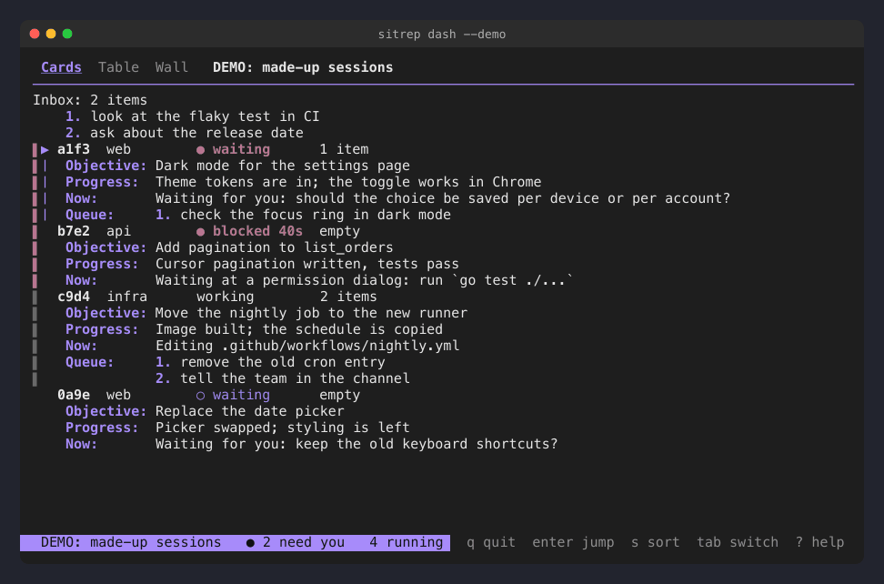
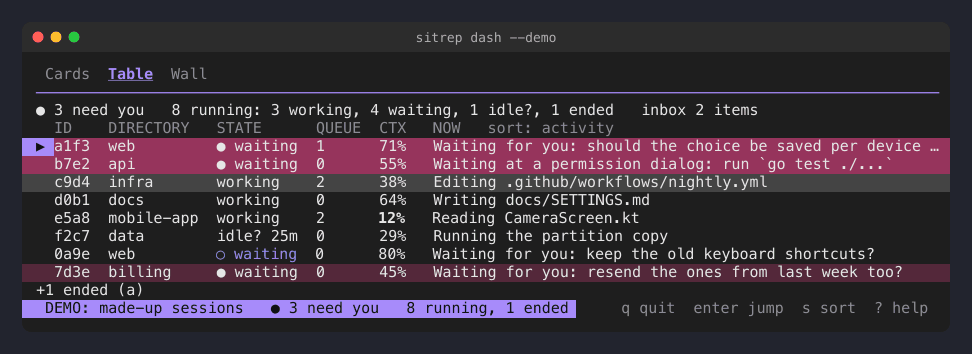
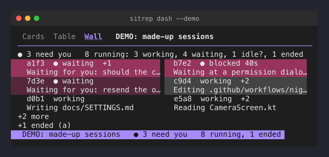

# claude-sitrep

A to-do list for each of your Claude Code sessions, and a dashboard that shows which one is waiting for you.



*`sitrep dash --demo`, on made-up sessions.*

- `●` the session needs you, `○` it is snoozed, and `▶` marks the selected row.
- Objective, Progress and Now say what a session is for, how far it has got and what it is doing right now.
- Queue is your list of what comes next for that session. Inbox is your list for work that has no session yet.

When you run several Claude Code sessions, you think of the next thing to ask one of them while it is still busy, or of something for another session. Where does that go? Into your head, a scratch file, or a prompt you have to remember to send. And you lose track of which session is waiting for you.

## Why sitrep

Other tools, including Claude Code's own Agent View, show which sessions are working and which are waiting. sitrep also keeps your own list of what comes next, for each session, and shows it under the prompt.

1. **A queue for each session.** Type `+ <text>` in a prompt to queue an item without sending anything to Claude. The queue is yours: nothing in it goes to Claude unless you ask, and the next item shows under the prompt.
2. **An inbox for work that has no session yet.** Write it down now, and take the item into a session when you know where it belongs.
3. **A report for each session.** The Objective, the Progress and what it is doing Now show under each prompt. A short Haiku call rewrites them after each turn (see Privacy And Safety for the cost cap and what is sent).
4. **A dashboard that puts the sessions that need you first.** A session that has stopped and waits for you has a `●`, and the terminal bell rings when one newly does.
5. **Nothing to run.** It is one Go program with plain files, so the status line renders at once and there is no server.
6. **A full command-line tool, and yours to script.** Every action is a command (`sitrep add`, `rm`, `move`, `top`, `snooze`, `pin` and more), each with `--help`, and bash completion fills in commands, flags and session ids. `sitrep ls --json` is a stable JSON format for your own tools.

Limits: Claude Code only, one machine (other machines can be reached over ssh, see [docs/REMOTE.md](docs/REMOTE.md)), no cost tracking, and it cannot answer a session's approval prompts. [docs/COMPARISON.md](docs/COMPARISON.md) compares it with Agent View, claudectl, Plate-Spinner and the kanban boards, and says when one of them is the better choice.

To install, run `/plugin install sitrep --marketplace lfeagan/claude-sitrep` in Claude Code, then `/sitrep:setup` (it needs Go 1.26 or newer and the `claude` CLI; see [Install](#install)). To look around first, with nothing installed, run `go run github.com/lfeagan/claude-sitrep/cmd/sitrep@main dash --demo` (it needs Go 1.26 or newer, and shows made-up sessions).

## Contents

[Why sitrep](#why-sitrep) · [What It Looks Like](#what-it-looks-like) · [Install](#install) · [The Queue](#the-queue) · [The Dashboard](#the-dashboard) · [Settings](#settings) · [For Programs](#for-programs) · [Privacy And Safety](#privacy-and-safety)

More detail is in `docs/`: [Install and update](docs/INSTALL.md), [the queue](docs/QUEUE.md), [listing and pruning](docs/LISTING.md), [the dashboard](docs/DASHBOARD.md), [the themes](docs/THEMES.md), [all settings](docs/SETTINGS.md), [the history log](docs/LOG.md), [the JSON format](docs/JSON.md), [how it works](docs/HOW-IT-WORKS.md) and [remote machines](docs/REMOTE.md).

## What It Looks Like

The dashboard has three tabs, and `tab` switches between them. Cards shows the detail of a few sessions, as above. Table is a quick scan of many. `CTX` is the share of the context window left, so a low number is a warning, and it is bold when it is low. `idle?` marks a working session that has been quiet for a while:



Wall shows the sessions as tiles, many to a screen, with those that need you first. Text is cut to the width of a tile:



There are 38 colour themes, most with a dark and a light form, and `sitrep colors` is a tool for choosing one or making your own. [The themes page](docs/THEMES.md) shows some of them, and the colour-blind view of `cvd-safe`.

## Install

You need Go 1.26 or newer (`go version`) and the `claude` CLI. Go is needed only to build the program: what you run afterwards is one program with plain files, and no runtime to keep up to date. sitrep runs on macOS and Linux; it uses file locks and process groups, so there is no Windows build. On Windows, use WSL.

1. In Claude Code, run:

   ```
   /plugin install sitrep --marketplace lfeagan/claude-sitrep
   /sitrep:setup
   ```

   The first line installs the plugin (the program's source, the hooks and two skills). A plugin cannot build a program or declare a status line, so `/sitrep:setup` builds the program into `~/.claude/sitrep/bin/sitrep`, points the status line at it (an existing status line, such as Claude HUD, is saved and runs first), and links `sitrep` into `~/bin`. Claude Code asks before it changes `~/.claude/settings.json`, which setup backs up first.
2. Restart your Claude Code sessions, and send a prompt in one. The status block shows under the prompt, and the session appears in the dashboard. With no sessions the dashboard shows only the tabs and `0 running, 0 ended`, and fills in as sessions start.
3. In any terminal, run `sitrep dash` (`sitrep dash --demo` shows made-up sessions, if you want to look around first). Press `?` for the keys and `q` to quit. Setup links `sitrep` into `~/bin`, so that folder must be on your `PATH`; if the shell says `sitrep: command not found`, add it, or run `~/.claude/sitrep/bin/sitrep dash`.

A session "needs you" when Claude has stopped and the next move is yours, or when it waits at a permission dialog. It has a `●` before its state, and the dashboard puts it first.

Start on Cards for a few sessions, Table for many, and Wall when you have more than fit on a screen. The `Inbox` line is work you queued for no session yet. `enter` jumps to the terminal that shows the selected session, `z` snoozes one that can wait (it then shows a `○` instead of the `●`, and the snooze ends by itself when the session changes), and `n` gives a session a name. The colour of a row that needs you fades after ten minutes, and the `●` stays.

### Updating

When a newer release exists, the status line says so under the queue line. Update the plugin, restart Claude Code, then run `/sitrep:setup` again, so that the program matches the plugin. From a clone, run `git pull --tags && make install`. The details, upgrading from 0.3.x and taking sitrep out are in [docs/INSTALL.md](docs/INSTALL.md).

## What You See

```
Objective: Build a three-line status block for my sessions
Progress:  Wrote the wrapper and hooks; summarizer tested against a fake transcript.
Now:       Waiting on a repo name.
Queue [id a1b2]: 2 items, next: update README
```

The block works as follows:

1. Objective starts as the first prompt (a resumed session is seeded from its transcript), so the raw prompt shows until the first turn finishes. A short title written by the same Haiku call that writes Progress and Now then replaces it. A pinned Objective (`+pin` or `sitrep pin`) stays until you run `sitrep unpin`.
2. Progress and Now are rewritten after each turn by a short Haiku call that reads the tail of the transcript.
3. Queue shows how many items are waiting, the next item and the first four characters of the session id, which is how `sitrep` addresses the session (`sitrep add a1b2 ...`).

## The Queue

`sitrep` addresses a session by any unique prefix of its id, as shown in the status line and in `sitrep ls`, or by a name you gave it. `sitrep help` lists the commands, and `sitrep help <command>` shows the details of one.

1. `sitrep ls` lists running sessions with their queue, Objective and Now, and `sitrep ls <id>` lists one queue.
2. `sitrep add <id> <text>` appends an item, and `sitrep rm <id> [n]` (or `done`) removes item `n` (default 1).
3. `sitrep move <from> <to> [n]` hands an item to another queue, `sitrep top <id> <n>` moves it to the front, and `sitrep edit <id> <n> <text>` rewords it.
4. `sitrep pin <id> <text>` pins a session's Objective, and `sitrep alias <id> <name>` gives a session a name.

The inbox is a queue that belongs to no session, for work you have not yet matched to one: use `inbox` where a command takes an id (`sitrep add inbox <text>`). Inside a Claude Code session, `+ <text>` queues the text to this session, `+inbox <text>` to the inbox, `+take [n]` takes an inbox item, and `+pin <text>` pins the Objective; none of them is sent to Claude. The full list of commands, the guards that keep a program from changing the wrong item, and the exact rules for the prefixes are in [docs/QUEUE.md](docs/QUEUE.md).

`eval "$(sitrep completion bash)"` in `~/.bashrc` completes commands, flags and session ids.

## Listing Sessions

`sitrep ls` prints a table of the running sessions: id, directory, state and queue, then Objective and Now, newest first. `-v` adds Progress and every queue, and `-a` adds ended sessions. A `●` before the state marks a session that needs you, and a `○` one you snoozed. The state comes from the hooks: `working` from the moment a prompt goes to Claude, `waiting` when Claude has stopped and it is your turn, `blocked` while it waits at a permission dialog, and `ended` when the session exits. A `working` session that has been quiet for ten minutes shows `idle?`, since Claude Code fires no hook when you interrupt a turn. `sitrep prune` tidies sessions that are gone. How a session counts as running, the hidden lines, what an unreadable state folder does and `prune` are in [docs/LISTING.md](docs/LISTING.md).

## The Dashboard

`sitrep dash` is a full-screen view of all your sessions, with a status bar. Without a terminal it prints one frame and exits, and `sitrep status` always does.

1. **Cards** shows Objective, Progress, Now and the queue of each session.
2. **Table** is a summary line and one line per session, with its state, queue size, the share of its context window left (CTX) and what it is doing now.
3. **Wall** lays the sessions out as tiles of one size, in as many columns as the width holds, for twenty sessions at once. The sessions that need you come first, `h` `l` `j` `k` move between tiles, and `s` changes the tile size.

A session that needs you, meaning Claude has stopped and the next move is yours, or it waits at a permission dialog, has a `●` before its state and a coloured background, and the status bar leads with `● 2 need you`. The colour fades after ten minutes (`SITREP_ATTN_FADE`, see [docs/SETTINGS.md](docs/SETTINGS.md)) and the `●` stays. The terminal bell rings once when a session starts needing you.

`sitrep colors` is a tool for choosing the colours: it previews every use of colour on made-up sessions, lets you pick each one, and writes the two settings to `sitrep.conf` when you say so (see [the dashboard](docs/DASHBOARD.md#colours)); `C` in the dashboard opens it too.

The keys you need first:

| Key | What it does |
| --- | --- |
| `j` `k` `gg` `G` | Move the selection. |
| `enter` | Jump to the terminal that shows the selected session (tmux, cmux, iTerm2 and Terminal.app). |
| `v` or space | The selected session in full. |
| `tab` `h` `l` | Switch tab. |
| `/` | Filter the sessions. |
| `e` `i` | The selected session's queue, and the inbox. |
| `n` | Name the selected session. |
| `z` | Snooze a session that can wait. |
| `?` | Every key and colour. `q` goes back or quits. |

The dashboard rings the terminal bell once when a session starts needing you; `sitrep dash --no-bell` (or `SITREP_TUI_BELL=0`) turns that off, and `z` mutes one session. `--mouse` makes a click select a row (or a tile), a click on a tab name open that tab, and a double click jump. All keys, how the jump works for each terminal, the queue screens, the options (`--read-only`, `--no-bell`, `--interval`) and the colours are in [docs/DASHBOARD.md](docs/DASHBOARD.md).

## Settings

Defaults live in `~/.claude/sitrep/sitrep.conf` or the environment, and the environment wins. `sitrep setup` keeps a block of commented examples at the end of the file. The ones most people want:

1. `SITREP_THEME=<name>` picks the dashboard's colours: `default`, `pastel`, `rainbow`, `high-contrast`, `mono`, or one of thirty-three more (`ocean`, `forest`, `eighties`, `blues`, `reggae`, `tokyo`, `coffee`, `cvd-safe` and others, listed in [docs/SETTINGS.md](docs/SETTINGS.md#the-themes)); `sitrep colors` shows them all.
2. `SITREP_STATUS_LINES=<names>` chooses which lines of the status line show: any of `objective`, `progress`, `now` and `queue` (default all four).
3. `SITREP_QUEUE_ITEMS=<items>` is the queue list limit (default 5).
4. `SITREP_CHECK_UPDATES=<0|1>` lets sitrep look once a day for a newer release (default on). It is the only setting that uses the network, and 0 turns it off.
5. `SITREP_LOG=on` turns on the history log (default off), which keeps the text of your items.

The rest (single colours, how long a session that needs you keeps its colour, refresh, debounce, a state folder of your own and the log limits) are in [docs/SETTINGS.md](docs/SETTINGS.md).

## For Programs

`sitrep ls --json` prints one JSON document that describes the running sessions, for a program that draws its own view. It always prints a valid document, every text field is a single line with no control characters, and `version` changes only when a field is removed or changes meaning, so a program should ignore fields it does not know. `needs_input` is the field that says a session waits for you. The fields are in [docs/JSON.md](docs/JSON.md), and the history log, `sitrep log --json`, is in [docs/LOG.md](docs/LOG.md).

## How It Works

State is plain files in `~/.claude/sitrep/`, so the status line renders instantly and there is no server. The hooks run `sitrep hook`, which answers within milliseconds, and a short Haiku call writes Progress and Now afterwards in a detached process. The layout, the files and the migration of older state are in [docs/HOW-IT-WORKS.md](docs/HOW-IT-WORKS.md).

## Privacy And Safety

Session state is stored in `~/.claude/sitrep`, which is owner-only (`700`, files `600`). Prompt and model text is treated as untrusted terminal input, so control characters (escape sequences and the C1 range) and format characters (such as bidi overrides) are removed before it is stored and again before it is printed. The summarizer sends the tail of the transcript to Haiku through `claude -p`, the same service the session itself uses. It runs from an empty temporary directory with no tools, no MCP servers, no settings and a 60 second limit, in its own process group that the limit ends whole, and only reads transcripts that live under `~/.claude/projects`. The daily update check is the only other network use: it asks this repository for its tag names and sends nothing from your sessions.

## Development

`make test` runs `gofmt`, `go mod tidy -diff`, `go vet` and `go test -race`, in CI on Linux and macOS. `make build` builds `./sitrep`. The tests use a throwaway `$HOME` and a stub `claude`, so they never touch real settings or the API. The scenario tests run the built program through commands and hook events and compare with golden files (`go test ./internal/cli -update-golden` rewrites them). They began as comparisons with the last shell version, the git tag `bash-final`, which nothing uses now. `docs/GO-PORT.md` describes the port from shell to Go.

## Status

The queue does not feed work to Claude automatically. With `SITREP_QUEUE_NUDGE=on` the hooks tell Claude how many items are queued, so that it asks you whether to start the next one when a task is done; it never starts one without a yes (see [docs/QUEUE-NEXT.md](docs/QUEUE-NEXT.md)). Whether a `Stop` hook should hand over the next item on its own is still undecided, as an unattended session that keeps itself busy is also a runaway session. Pushing the same text to the cmux sidebar has not been built; the state is plain files, so a script can read it.

## License

MIT. See `LICENSE`.
