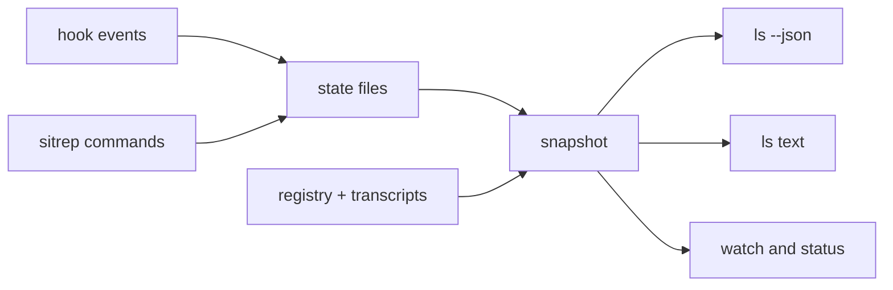

# Porting sitrep to Go

Status: draft 2, after the first review. Nothing here is built.

## Purpose

This document proposes replacing every shell script in claude-sitrep with one Go program, and the way to get there without breaking the working system. After the port the repository holds no bash, no `jq` and no `perl`, and the user builds one binary during setup.

## Where We Are

The engine is about 1,100 lines of bash across six scripts, and the dashboard is about 2,700 lines of Go (about 5,600 with its tests) that shells out to the engine.

| Piece | Lines | Does |
| --- | --- | --- |
| `bin/sitrep` | 641 | queue commands, liveness, `ls`, `ls --json`, `watch`, `prune`, `tui` launcher, help for 13 commands |
| `hooks/sitrep-hook.sh` | 196 | state, `+pin` `+` `+inbox` `+take`, debounce, Haiku summarizer, plugin refresh |
| `statusline/statusline.sh` | 30 | upstream status line plus the sitrep block |
| `setup.sh`, `install.sh`, `uninstall.sh`, `lib/` | 227 | merge hooks and status line into `settings.json` |
| `tests/run.sh` | 1,281 | the shell suite: about 360 `check` and `eq` call sites, several inside loops, so the real count is the `passed:` line it prints |
| `tui/` | ~2,700 | Bubble Tea dashboard, jump, queue edits, 18 golden files, its own `go.mod` |

The shell code leans on `jq` for JSON, `perl` for Unicode, `stat` in two dialects and `ps`, and every hook call starts several processes.

## Goals and Non-Goals

1. One static binary, `sitrep`, with every command, the hook, the status line, setup and the dashboard as subcommands.
2. The behavior stays the same. This is a port, not a redesign. Only change one thing at a time, and always keep a working system.
3. The state files keep their names and formats, so a running session carries on.
4. `sitrep ls --json` keeps its document (version 1), since it is a public contract.
5. Every invariant in `AGENTS.md` still holds, enforced by shared code instead of by each script.

Non-goals: Windows, a new storage backend (the sqlite item stays separate), a new look for any screen, and any migration code. The author is the only user and cleans up their own 0.3.x install by hand.

## Dropped With the Bash

1. The plain `watch` loop (`watch_loop`, `sig`, `termsize`, `wrap`, the highlight marker, and the flags `--wrap`, `--highlight`, `-n` and the positional seconds). `sitrep watch` becomes today's dashboard, and its `--interval` replaces the seconds. `sitrep tui` goes away, and `sitrep status` prints one frame of that dashboard as plain text (today's `--once`, with `--tab`, `--width` and `-a`), which replaces `watch --once`. `ls` and `ls -v` keep their own plain text, which never wrapped.
2. The checkout installer (`install.sh`, `uninstall.sh`), `--alias`, the `~/.claude/skills` link, the `~/.claude/session-notes` and `~/.claude/sitrep.conf` moves, and the `notes-hook.sh` and `q` clean-ups. Setup is plugin-only: `sitrep setup` and `sitrep setup --remove`. Decided; no `sitrep install` for a bare clone.
3. The `plugin` link, the copied `statusline.sh`, the `SessionStart` refresh in the hook, and `sitrep tui --build`.
4. `sitrep-tui` as a separate program, and the `SITREP_BIN` and `SITREP_TUI` lookups. There is one binary, and the dashboard is `sitrep watch`. No link or wrapper is kept; the author edits their own tmux bindings.

`sitrep setup` keeps the guard from invariant 5: it stops and names what it finds when an old checkout install is still in settings.

## Proposed Shape

One module at the repository root. `tui/` stays its own module and keeps building until Phase 8, so `make tui-test` and CI do not break on the way.

```
cmd/sitrep/main.go        flag dispatch only; the recursion guard runs first
internal/textsafe/        Text type, Clean, Strip, Fit, display width      (invariant 1)
internal/state/           state dir, ids, atomic write, modes, flock       (invariants 2, 3)
internal/conf/            sitrep.conf and the SITREP_* settings
internal/clock/ runner/   injectable time, and one wrapper for ps, tmux, cmux and claude
internal/queue/           add rm top reorder move, --item guards, typed results
internal/live/            registry, ps start time, deadp, transcript quiet time
internal/snapshot/        the typed Snapshot; ls --json is its encoding
internal/render/          plain text for ls and ls -v
internal/hook/            events, +commands, debounce, summarizer
internal/statusline/      wrapper and block
internal/settings/        settings.json edits
internal/setup/           setup and remove                                  (invariant 5)
internal/tui/             today's tui/, as a library, from Phase 8; sitrep watch and sitrep status
```



The seam moves. Today the JSON is the line between the engine and the dashboard. After the port the typed `Snapshot` is, and `ls --json` is one encoding of it. Settled decisions 1 and 2 in the project notes are superseded, and the user asked for it. Decision 3 holds: the dashboard acts only through the same fixed operations, after a confirm, and `--read-only` switches them off.

The dashboard reads text from the engine in three places that the port shall replace with typed results: the prune preview (`would mark`, `would ask`, `marked`, `moved`, in `tui/prune.go`), the last line of a queue command (`tui/queue.go`), and the "queue changed" failure of a `--item` guard. `internal/queue` returns structs and an `ErrQueueChanged`, and the CLI prints the same words from them. The goldens `prune_*` and `queue_*` shall not change.

## How the Invariants Carry Over

| Invariant | In Go |
| --- | --- |
| 1 Strip Cc and Cf | `textsafe.Text` is a distinct type that only `Clean` and `Strip` can produce, and render and encode functions accept nothing else. That replaces a lint test, which could not be enforced. Both layers stay: the producer cleans, and the dashboard cleans what it decodes and what it reads from `ps`, `tmux` and `cmux`. Pin the Go version and diff the Cc/Cf tables against perl's on the hostile fixtures. |
| 2 Owner-only files | Explicit modes everywhere (`0600` files, `0700` directories), asserted in tests, because a `Umask` call does not reach in-process tests. `syscall.Umask(0o077)` stays in `main` as well. `os.CreateTemp` in the state dir, rename to publish. The hook still sets the state directory to `0700` on every run. A new `settings.json` and its backup are `0600`. |
| 3 Session ids | `state.ValidID` guards hook input, registry ids, file-name globs and `resolve`, which keeps its prefix match, the exact `inbox`, and the "matches N" error. Transcripts are checked on the raw path (the `/../` test before any `Clean`), need the literal `<config>/projects/` prefix, and open with `O_NOFOLLOW` after an `Lstat`. |
| 4 Hooks never fail | `main` wraps everything in `recover` and exits 0 with clean stdout on any failure. Locks have a bounded wait, so a stuck holder never blocks a prompt. Block only after the write has succeeded. |
| 5 Installers | Same rules in `internal/setup`. Because `~/.claude/sitrep/bin/sitrep` is now the live binary, no code may `rm`, `chmod` or recurse over `bin` or `plugin` in the state folder, and `chmod` stays files-only and never through a link. `setup --remove` deletes the binary it runs from, which is fine on Unix. |
| 6 Tag, `stat` | The tag stays. The `stat -c` versus `stat -f` rule disappears. |
| 7 Summarizer isolated | `exec.CommandContext` with a 60 second deadline, an empty temp `Dir`, `Setpgid` so the deadline kills the whole group, `SITREP_SUMMARIZING=1`, the frozen argv below, and the stale-count check before the write. |

The state directory is always `$HOME/.claude/sitrep`. Only transcripts, the registry and the transcript quiet time honor `CLAUDE_CONFIG_DIR`. A tidy port that unified the two would orphan every user's state, so `internal/state` says so in a comment and a test.

## The Hard Parts

1. **The hook outlives itself.** The bash hook backgrounds the summarizer and a deferred debounce run. A Go hook shall re-run its own binary as a detached child (`sitrep hook-summarize`, `Setsid`, stdio on `/dev/null`) and return at once, or Claude Code waits on the pipes. The `.pending` flag is never cleared today if the child dies, and a later Stop in the window then returns early for ever. The port stores the due time in `.pending` and treats an old one as stale.
2. **Concurrent queue edits.** Edits take `flock` on `<id>.queue.lock`, with a bounded wait, and a hook append takes the same lock. `move` and `+take` take two locks in sorted id order. This closes the known lost-`add` gap only once no bash writer is left, so it lands in Phase 8, as its own commit. Prune removes lock files and stray `.sitrep.*` temporaries of ended sessions.
3. **Editing `settings.json`.** Setup validates with `json.Valid` first, because `gjson` accepts malformed input, and checks that `statusLine` is an object. It backs up, edits into a temp file, and only then replaces the file. The write resolves a symlink with `EvalSymlinks` and renames inside the target's directory, so a symlinked `settings.json` stays a link and is never left half written. The hook edit is not a path set: it removes our group from each of four events, drops empty groups and events, and drops `hooks` when it ends up empty, matching by exact command. Decided: `tidwall/sjson` and `gjson` make the in-place edits, so key order and formatting stay as the user wrote them.
4. **`sitrep.conf` is shell.** Today it is sourced by three scripts and written with `printf %q`. The Go reader accepts `KEY=value` lines with single or double quotes, and the writer quotes with single quotes (`'` as `'\''`). It replaces only the `SITREP_HUD_CMD` line, removes the file when nothing else is left, and keeps the user's lines. The environment wins over the file everywhere. Today the status line lets the file win, which is a small change I shall list in the commit.
5. **Unicode and widths.** `fit` in `ls` used character counts and the dashboard uses `displaywidth`. One width function, the library one; `ls` output may change for wide characters, and each change is named in its commit. Truncation is on runes after stripping, `clean` right-trims and `sane` does not, as today.
6. **Process start time.** The registry check compares `procStart` with `ps -o lstart=` under `LC_ALL=C TZ=UTC`, and uses `pidDomain`, `/etc/machine-id` and `/proc/self/ns/pid` on Linux. All of it moves over, behind the `runner`, so one `ps` wrapper serves `live` and the dashboard's jump.
7. **JSON bytes.** The contract is the document. The encoder turns off HTML escaping, and tests compare decoded values. Go still escapes U+2028 and U+2029, which is harmless. Key order is kept, and `null` stays `null` for a missing `pid` and `quiet_secs`.

## Behaviors the Port Must Carry

The reviewer found these in the bash. Each becomes a differential case before the code that handles it.

1. **Hook order.** `SITREP_SUMMARIZING` exits before stdin is read. The prompt count is bumped before the `+` handlers, so `+` prompts count. A `+` command works only for a short single line (no newline, 200 characters at most, not blank), `+inbox` strips leading spaces and `+ ` and `+pin ` do not, `+take N` needs `[1-9][0-9]*`, and a failed write falls through to Claude. A block is `{"decision":"block","reason":...}` with exit 0. A placeholder Objective (`-`, `<...`, `&lt;...`, `<command-`) counts as unset.
2. **Events.** `SessionEnd` writes `ended` and exits before the cwd write. Every other event rewrites `<id>.cwd`. `SessionStart` with `source=compact` leaves the state alone. A resumed session is seeded with `(resumed -- summarizing)` and summarized only when an Objective was found.
3. **Summarizer input.** The last 40 transcript lines, each cut to 600 characters, then the last 6000 bytes, cut on a rune boundary. The argv is frozen: `claude -p --model haiku --no-session-persistence --disable-slash-commands --tools "" --strict-mcp-config --mcp-config '{"mcpServers":{}}' --setting-sources "" --max-budget-usd 0.05`. A bad transcript line is skipped, and the scanner buffer is large enough for the 400 KB line.
4. **First prompt.** The first user message whose text does not start with `<` or `&lt;`, text parts joined by a space, first non-blank line.
5. **The CLI contract.** `die` prints `sitrep: <message>` to stderr and exits 1. `ls` is the default command. `-h` and `--help` work on every command. The help text of all 13 commands is copied verbatim, and the existing help loop test runs against it. All usage strings, the `--item` parsing and `same()` (equal but for trailing spaces) carry over, and so do the `ls <id>` header, the `(queue empty)` line, and the footers `+N more`, `+N ended (--all)` and `N items stranded`.
6. **Liveness numbers.** 120 seconds of grace, 600 seconds before `idle?`, a 24 hour listing window, and the snooze equality rule.
7. **Terminal handling.** `ls` takes its width from `LINES` and `COLUMNS` with the 24 by 100 fallback and the 3 and 10 minimums. The dashboard keeps its own handling (`NO_COLOR`, the highlight color from the snapshot, digits and semicolons only). `sitrep watch` without a terminal (a pipe, or `TERM=dumb`) prints one frame like `status`, never a loop of escape codes, as the bash `watch` does. Each gets a case.

## Distribution

Decided: the user builds the binary during setup, so Go 1.26 or newer is a requirement. A plugin is a git checkout and holds no binary, so `/sitrep:setup` builds one and puts it at the stable path `~/.claude/sitrep/bin/sitrep`.

1. **Primary:** `go build` in the plugin's own checkout, to a temp file in `bin`, then rename (`-mod=readonly`). It always matches the plugin version and needs no tag or module proxy.
2. **Fallback:** `GOBIN=~/.claude/sitrep/bin go install github.com/lfeagan/claude-sitrep/cmd/sitrep@v0.4.0`.
3. Setup stops with a plain message, changing nothing, when `go` is missing or too old.

The setup skill runs the `go` command first and then `sitrep setup`, so its allowed tools name `go` and the binary, and no script stays in the repo. The hook command in `hooks.json` is still a shell line, because Claude Code runs it through a shell, but it holds no sitrep logic: `"$HOME/.claude/sitrep/bin/sitrep" hook`.

What this costs, plainly:

1. **A missing binary is noisy.** After the plugin updates and before `/sitrep:setup` runs, each hook exits 127, which Claude Code reports as a non-blocking error. Until then `+ text` and `+pin` are not intercepted and go to Claude as real prompts. This is a short window and a single user, so I accept it, and the setup skill says to run it after every update.
2. **The binary does not follow the plugin.** The stable path means nothing upgrades the binary. The status line prints a one-line notice when `sitrep version` differs from the version in the plugin's `plugin.json`.
3. **Rollback needs one step.** The 0.3.x `setup.sh` refuses when the status line ends in `# claude-sitrep` and is not its own command, so a downgrade starts with `sitrep setup --remove`. No tags exist yet; Phase 0 creates `bash-final` (and `v0.3.0` on the same commit), and the version stays 0.3.0 until the cutover, so users of the plugin cache are not moved early.

## Test Strategy

1. **Oracle.** Phase 0 creates the tag and records the `passed:` count from `bash tests/run.sh`. The bash suite stays, and stays green, until Phase 8. The harness materializes the tag with `git archive` into a temp directory, since nothing needs building. It needs `jq` and `perl` on CI until then.
2. **Injected clock and runner.** Differential tests are flaky without them: `generated`, ages, `waiting 3m`, mtimes, `ps lstart`, real pids and the debounce `sleep` all vary. `internal/clock` and `internal/runner` exist from Phase 1, and tests normalize what remains.
3. **Differential tests.** The same scenario runs through both, comparing exit status, stdout and the resulting state files. This proves parity for `ls`, `ls --json`, the queue commands, prune and the hook.
4. **Port the cases.** Each section of `tests/run.sh` becomes Go tests, mostly `testscript` files (`rogpeppe/go-internal`) with a fake `$HOME` and stubs for `claude`, `ps` and `tmux` (the shell suite stubs only `claude`). The ported count shall be at least the bash count, shown per section in the commit that deletes the bash. Retired on purpose, and listed as such: the eight-process refresh race (`tests/run.sh:1270`), the `--build` stub, and the checkout-install cases.
5. **Fixtures first.** Hostile text, C1 and bidi, the 400 KB line, the 600-session listing, a symlinked `settings.json`, and paths with spaces are carried over as fixtures before the code they test.
6. **Frozen outputs.** When the bash is deleted the oracle goes with it, so Phase 7 records the old outputs as fixtures for later regressions.
7. **Real terminal.** The pseudo-terminal test of the bash `watch` loop is retired with the loop. The dashboard already has model and golden tests, and the no-terminal gate gets a case.
8. After each fix, break the code on a copy and see the new test fail.

## Phases

Each phase runs the loop: design check, build with tests, fresh review, fix. Phases 1 to 4 are faithful ports of settled behavior (the bash `watch` loop is retired, not ported), so their design check is a short note. Phases 5, 7 and 8 get a full design review. `main` keeps working, because the Go program is additive until Phase 8, and the plugin version stays 0.3.0 until the last commit of Phase 8, so nobody receives a half-port.

| Phase | Content | Done when |
| --- | --- | --- |
| 0 | Tag `bash-final` and `v0.3.0`, record the count, root `go.mod`, `clock` and `runner`, the differential harness | the harness runs one scenario against both |
| 1 | `textsafe`, `state`, `conf` | the hostile fixtures match perl, `make lint test tui-test` unchanged |
| 2 | `queue` with typed results, and the queue commands with the CLI contract and help text | queue, reorder, inbox, `--item` and help cases pass, both ways |
| 3 | `live`, `snapshot`, `ls --json`, prune, snooze | decoded JSON equals the bash output on every fixture |
| 4 | `render`: `ls` and `ls -v` only | text equals the bash text, except the listed width cases |
| 5 | `hook`, with the detached summarizer and the debounce | the hook cases pass, and a test shows the hook returning at once |
| 6 | `statusline`, with the version notice | the status line cases pass |
| 7 | `settings` and `setup`, with `--remove`, and the frozen outputs | the settings cases pass: order, symlink, bad JSON, failure before any write, modes |
| 8 | Cutover, in four commits: (a) `tui` into the root module as a library, calling `queue` and `live` directly, named `sitrep watch`, with `sitrep status`, Makefile and CI following; (b) `flock`; (c) `hooks.json`, manifests, the setup skill, version 0.4.0; (d) delete the bash and `tests/run.sh`, CI without shellcheck, README and `AGENTS.md` | CI is green on Ubuntu and macOS, a clean `$HOME` setup works end to end, and the 0.3.x clean-up and the upgrade were run by hand |

Rollback cost of Phase 8: revert commit (c) and (d) and publish a patch release, then run `sitrep setup --remove` on any machine that already set up. Phases 0 to 7 cost nothing to roll back, since no user-facing file changes.

## Measurements to Take

1. Hook latency for `UserPromptSubmit`, bash today against Go, over 100 runs, as numbers.
2. Binary size with Bubble Tea linked in, and the hook's startup time with it. The rule is set now: if the p95 of a hook call is over 30 ms, the fix is in the one binary (lazy initialization, fewer package-level initializers, trimmed imports on the hook path), and it is never a second binary.
