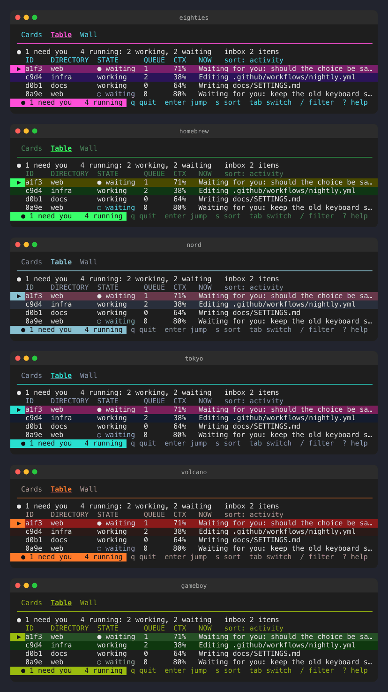
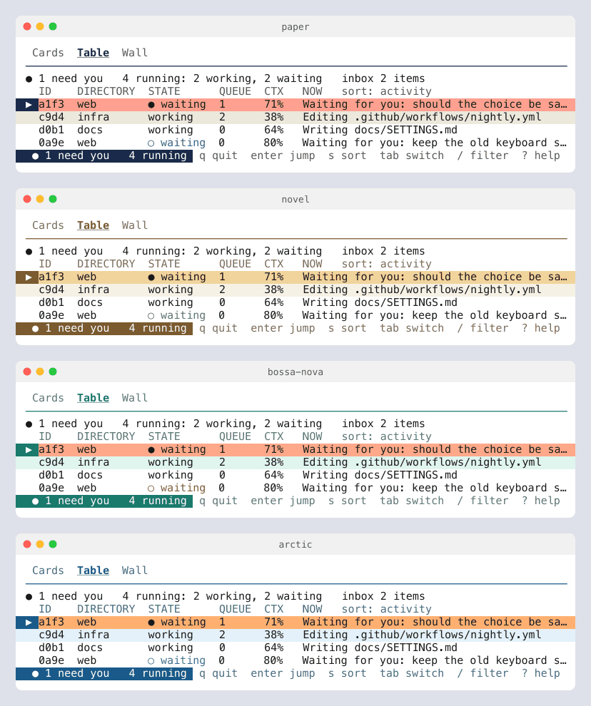
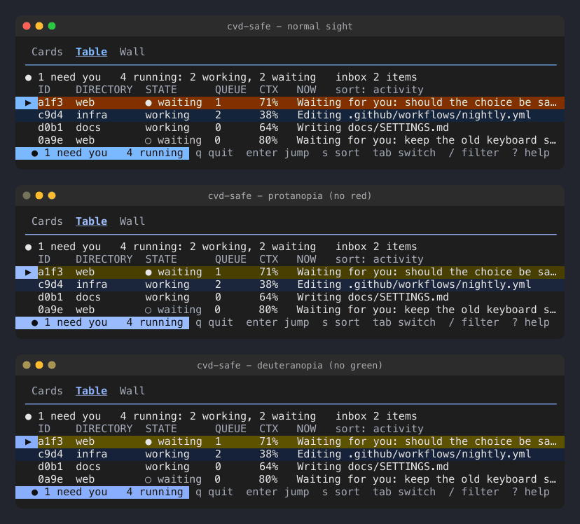

# The themes

There are 38 themes, most with a dark and a light form, and sitrep picks the side your terminal is on. A theme never repaints the terminal's background, only the rows, the bars and the marks. `SITREP_THEME=<name>` in `sitrep.conf` chooses one, and `sitrep colors` shows every theme in its own colours, lets you pick one, and lets you change single colours (see [the colour tool](COLORS.md)). Every theme and its mood is listed in [the settings](SETTINGS.md#the-themes).

Ten of them are shown here, each on the same four sessions: one needs you, one has recent activity, one is working and one is snoozed.

## Colour blindness

What needs you never depends on colour alone: it has a `●` and the word `waiting`, and a snoozed session has a `○`. The `cvd-safe` theme uses only blue and orange, apart in lightness. The picture shows it as it would look with normal sight, and with simulated protanopia and deuteranopia:

Every theme must keep a session that needs you clearly lighter than one with recent activity on a dark terminal, and deeper on a light one, so that the difference does not rest on hue alone. [The colour tool's design note](COLORS.md#reviewing-a-theme-by-eye-and-for-colour-blindness) says how to render any theme and its colour-blind views.

## Pictures

The pictures here and in the README are made from the program itself on made-up sessions: `make screenshots` redraws them, and `docs/theme-shots/readme_shots.py` draws them in windows and rewrites each as a palette PNG, which is a fraction of the size. Regenerate them only when the look changes, since every new version of a picture stays in the history.
